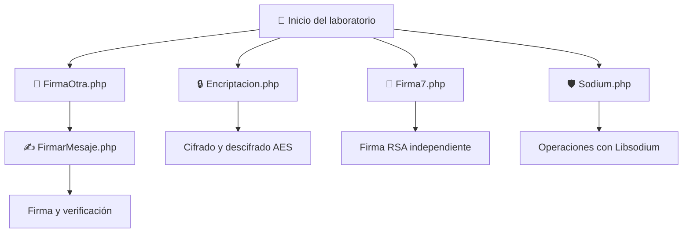

# 🔐 Laboratorio de Criptografía con PHP

<p align="center">
  
  
  
  
</p>

<p align="center">
  <b>Implementación de algoritmos criptográficos, cifrado, certificados y firmas digitales utilizando PHP.</b>
</p>

---

## 📌 Descripción del proyecto

Este repositorio contiene el desarrollo de un laboratorio práctico de criptografía utilizando el lenguaje de programación **PHP**, junto con las bibliotecas **OpenSSL** y **Libsodium**.

A través de diferentes ejercicios se implementan mecanismos de protección de información, como el cifrado y descifrado de mensajes, la generación de claves criptográficas, la creación de certificados digitales, la firma de mensajes y la verificación de firmas.

Además, se exploran las características de Libsodium, una biblioteca moderna que facilita la implementación de operaciones criptográficas seguras.

El proyecto tiene como finalidad comprender el funcionamiento de estas herramientas y su importancia en la seguridad de la información.

## 🎯 Objetivos

### Objetivo general

Implementar diferentes mecanismos criptográficos mediante PHP, utilizando OpenSSL y Libsodium para comprender su funcionamiento y aplicación en la protección de la información.

### Objetivos específicos

- 🔒 Aplicar algoritmos de cifrado simétrico para proteger mensajes.
- 🔑 Generar y administrar claves criptográficas.
- 📜 Crear solicitudes CSR y certificados digitales.
- ✍️ Implementar firmas digitales mediante RSA y SHA-256.
- ✅ Verificar la autenticidad e integridad de mensajes.
- 🛡️ Investigar las características, algoritmos y ventajas de Libsodium.

## 🧰 Tecnologías y herramientas utilizadas

| Tecnología | Función dentro del proyecto |
|---|---|
|  | Lenguaje de programación principal. |
|  | Cifrado, generación de claves, certificados y firmas digitales. |
|  | Operaciones criptográficas modernas. |
|  | Entorno de servidor local. |
|  | Entorno alternativo para ejecutar PHP. |
|  | Editor de código. |

## 📂 Estructura del repositorio

```text
📦 Laboratorio-Criptografia
 ┣ 📂 keysCert
 ┃ ┣ 📄 certout.pem
 ┃ ┣ 📄 privkey.pem
 ┃ ┗ 📄 solicitud.csr
 ┣ 📂 keys
 ┃ ┣ 📄 private_key.pem
 ┃ ┣ 📄 public_key.pem
 ┃ ┗ 📄 signature.dat
 ┣ 📂 docs
 ┃ ┗ 📂 img
 ┃    ┣ 🖼️ cifrado.png
 ┃    ┣ 🖼️ certificados.png
 ┃    ┣ 🖼️ firmas.png
 ┃    ┗ 🖼️ sodium.png
 ┣ 📄 Encriptacion.php
 ┣ 📄 FirmaOtra.php
 ┣ 📄 FirmarMesaje.php
 ┣ 📄 Firma7.php
 ┣ 📄 Sodium.php
 ┗ 📄 README.md
```

---

## ⚙️ Instalación y configuración

### 📋 Requisitos previos

Antes de ejecutar el laboratorio, es necesario contar con:

- PHP instalado.
- XAMPP o WAMP.
- Extensión OpenSSL habilitada.
- Extensión Sodium habilitada.
- Navegador web.
- Editor de código, como Visual Studio Code.

### 1. Clonar el repositorio

```bash
git clone URL_DEL_REPOSITORIO
```

### 2. Ubicar el proyecto

Coloca la carpeta del repositorio dentro del directorio de tu servidor local:

- **XAMPP:** `htdocs`
- **WAMP:** `www`

### 3. Habilitar las extensiones

Verifica que OpenSSL y Sodium estén habilitadas en el archivo `php.ini`.

También puedes comprobarlo desde la terminal:

```bash
php -m
```

Deben aparecer las extensiones:

```text
openssl
sodium
```

### 4. Configurar OpenSSL

Algunos ejemplos utilizan un archivo de configuración `openssl.cnf`. La ruta debe adaptarse a la instalación de PHP y OpenSSL de cada equipo.

### 5. Ejecutar el proyecto

Inicia Apache desde XAMPP o WAMP y accede desde el navegador:

```text
http://localhost/SeguridadOpenSSL-main/
```

Cada archivo PHP puede ejecutarse individualmente, teniendo en cuenta las dependencias entre algunos módulos.

---

## 🔐 Desarrollo de los módulos

### 1. 🔒 Cifrado y descifrado AES

<kbd>Archivo: Encriptacion.php</kbd>

Este módulo implementa el algoritmo de cifrado simétrico **AES-128-CBC** mediante OpenSSL.

El programa solicita al usuario un mensaje y una clave. Posteriormente, genera un vector de inicialización (IV) aleatorio y utiliza ambos elementos para cifrar el contenido.

También permite recuperar el mensaje original mediante el proceso de descifrado.

**Funciones principales:**

| Función | Descripción |
|---|---|
| `openssl_encrypt()` | Cifra el mensaje utilizando AES-128-CBC. |
| `openssl_decrypt()` | Descifra el contenido cifrado. |
| `openssl_cipher_iv_length()` | Obtiene la longitud requerida para el IV. |
| `openssl_random_pseudo_bytes()` | Genera bytes aleatorios para el vector de inicialización. |

**Proceso general:**

1. El usuario introduce el mensaje y la clave.
2. Se genera un IV aleatorio.
3. Se cifra el mensaje.
4. Se muestra el contenido cifrado.
5. Se realiza el descifrado utilizando la misma clave y el IV correspondiente.
6. Se recupera el mensaje original.

### 2. 📜 Generación de claves y certificados digitales

<kbd>Archivo: FirmaOtra.php</kbd>

Este módulo permite generar un par de claves RSA de 2048 bits, crear una solicitud de certificado (CSR) y producir un certificado autofirmado.

El programa solicita información para identificar al titular del certificado, como país, localidad, organización, nombre común y correo electrónico.

**Funciones principales:**

| Función | Descripción |
|---|---|
| `openssl_pkey_new()` | Genera un nuevo par de claves criptográficas. |
| `openssl_csr_new()` | Crea una solicitud de certificado CSR. |
| `openssl_csr_sign()` | Firma la solicitud para generar un certificado. |
| `openssl_x509_export()` | Exporta el certificado en formato PEM. |
| `openssl_pkey_export()` | Exporta la clave privada. |

**Archivos generados:**

- `certout.pem`: certificado digital.
- `privkey.pem`: clave privada.
- `solicitud.csr`: solicitud de certificado.

### 3. ✍️ Firma y verificación de mensajes

<kbd>Archivo: FirmarMesaje.php</kbd>

Este módulo utiliza la clave privada generada en `FirmaOtra.php` para crear una firma digital de un mensaje mediante RSA y SHA-256.

La firma se convierte a Base64 para facilitar su visualización y posterior utilización.

También permite verificar una firma introducida por el usuario utilizando la clave pública extraída del certificado digital.

**Funciones principales:**

| Función | Descripción |
|---|---|
| `openssl_sign()` | Genera la firma digital del mensaje. |
| `openssl_verify()` | Comprueba la validez de la firma. |
| `openssl_pkey_get_public()` | Obtiene la clave pública del certificado. |
| `base64_encode()` | Convierte la firma binaria a Base64. |
| `base64_decode()` | Recupera la firma en formato binario. |

**Proceso general:**

1. Se introduce el mensaje que se desea firmar.
2. Se utiliza la clave privada para generar la firma.
3. La firma se presenta en formato Base64.
4. Para verificarla, se introduce el mensaje original y la firma correspondiente.
5. Se utiliza la clave pública para comprobar su validez.

<badge color="warning">Dependencia importante</badge>

Es necesario ejecutar primero `FirmaOtra.php`, ya que este genera el certificado y la clave privada utilizados por este módulo.

### 4. 🔑 Firma digital independiente con RSA

<kbd>Archivo: Firma7.php</kbd>

Este módulo implementa un ejemplo independiente de firma digital utilizando RSA de 2048 bits y SHA-256.

A diferencia del módulo anterior, genera su propio par de claves, firma los datos y verifica la firma sin depender de los archivos creados por `FirmaOtra.php`.

**Funciones principales:**

| Función | Descripción |
|---|---|
| `openssl_pkey_new()` | Genera el par de claves RSA. |
| `openssl_pkey_get_details()` | Obtiene los detalles de la clave pública. |
| `openssl_pkey_export()` | Exporta la clave privada. |
| `openssl_sign()` | Genera la firma digital. |
| `openssl_verify()` | Verifica la firma generada. |

**Archivos generados:**

- `private_key.pem`: clave privada.
- `public_key.pem`: clave pública.
- `signature.dat`: firma digital.

### 5. 🛡️ Criptografía utilizando Libsodium

<kbd>Archivo: Sodium.php</kbd>

Este módulo explora el uso de **Libsodium**, una biblioteca criptográfica moderna que proporciona herramientas para implementar mecanismos de seguridad de forma eficiente.

Entre sus principales características se encuentran:

- 🔐 Cifrado simétrico autenticado.
- 🔑 Criptografía de clave pública.
- ✍️ Firmas digitales.
- 🔎 Funciones de hash.
- 🛡️ Protección de la integridad y autenticidad de los datos.

**Algoritmos disponibles en el ecosistema Libsodium:**

| Algoritmo | Aplicación |
|---|---|
| XChaCha20-Poly1305 | Cifrado autenticado. |
| ChaCha20-Poly1305 | Cifrado autenticado. |
| Curve25519 | Criptografía de clave pública. |
| Ed25519 | Firmas digitales. |
| BLAKE2b | Funciones hash. |
| Argon2id | Derivación de claves a partir de contraseñas. |

Libsodium destaca por ofrecer implementaciones modernas, una API sencilla y mecanismos que ayudan a reducir errores comunes al desarrollar aplicaciones criptográficas.

> Los algoritmos de la tabla representan funcionalidades de Libsodium; no significa que todos estén implementados en el archivo `Sodium.php`. Para conocer el procedimiento exacto, consulta el código del módulo.

---

## 🔄 Flujo de funcionamiento

El siguiente diagrama muestra la organización general de los ejercicios y sus dependencias:



## 🖼️ Evidencias de ejecución

A continuación se presentan los espacios destinados a documentar visualmente los resultados obtenidos en cada módulo.

### 🔒 Cifrado y descifrado AES


### 📜 Generación de certificados digitales


### ✍️ Firma y verificación de mensajes


*Figura 3. Generación y verificación de una firma digital.*

### 🛡️ Implementación con Libsodium


*Figura 4. Ejecución del ejemplo criptográfico utilizando Libsodium.*

> **Importante:** Guarda tus capturas reales en `docs/img/` utilizando los nombres indicados. Puedes cambiar las rutas de las imágenes según la organización de tu repositorio.

---

## 🔗 Relación entre los módulos

| Archivo | Dependencia | Funcionalidad |
|---|---|---|
| `Encriptacion.php` | Independiente | Cifrado y descifrado AES. |
| `FirmaOtra.php` | Independiente | Generación de claves y certificados. |
| `FirmarMesaje.php` | Requiere `FirmaOtra.php` | Firma y verificación de mensajes. |
| `Firma7.php` | Independiente | Firma digital RSA propia. |
| `Sodium.php` | Independiente | Ejemplo criptográfico con Libsodium. |

---

## ⚠️ Consideraciones de seguridad

- Las claves privadas deben mantenerse confidenciales.
- No se deben publicar archivos como `privkey.pem` o `private_key.pem` en repositorios públicos.
- AES-128-CBC requiere una clave del tamaño adecuado y un IV correctamente generado.
- CBC por sí solo no proporciona autenticación ni garantiza la integridad del mensaje.
- Los certificados creados en este laboratorio son autofirmados y no equivalen a certificados emitidos por una autoridad certificadora confiable.
- La verificación de firmas debe realizarse utilizando la clave pública correspondiente.
- Para aplicaciones reales se recomienda utilizar mecanismos de cifrado autenticado y buenas prácticas de administración de claves.

Se recomienda incluir un archivo `.gitignore` con el siguiente contenido:

```gitignore
keysCert/privkey.pem
keys/private_key.pem
```

## 👨‍💻 Autores

**Estudiantes:** Marcos Navarro, Samuel Orocú   
**Asignatura:** Desarrollo Web  
**Institución:** Universidad Tecnológica de Panamá 
**Fecha:** 30-10-2026

---

<p align="center">
  <b>🔐 La seguridad de la información comienza con una implementación criptográfica correcta.</b>
</p>

<p align="center">
  <i>Laboratorio práctico de criptografía — PHP · OpenSSL · Libsodium</i>
</p>
