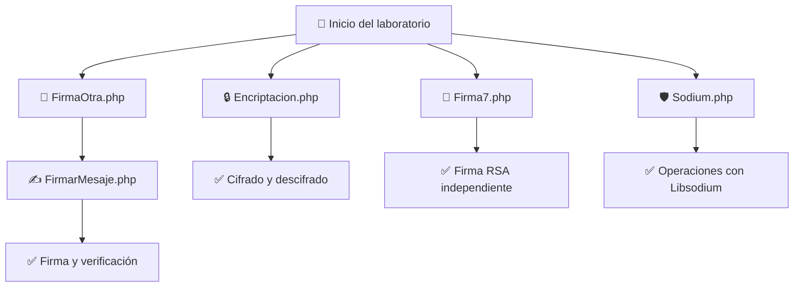

 
# 🔐 Laboratorio de Criptografía con PHP

<p align="center">
  
  
  
  
</p>

<p align="center">
  <b>Implementación práctica de técnicas criptográficas utilizando PHP, OpenSSL y Libsodium.</b>
</p>

---

## 📌 Descripción del proyecto

Este repositorio contiene el desarrollo de un laboratorio práctico de criptografía utilizando el lenguaje de programación **PHP** y diferentes herramientas de seguridad informática.

Se implementan ejemplos de cifrado y descifrado de información, generación de claves, creación de certificados digitales, firmas digitales y verificación de autenticidad mediante OpenSSL y Libsodium.

El propósito es comprender cómo funcionan los mecanismos criptográficos y cómo pueden utilizarse para proteger la información y garantizar su autenticidad e integridad.

## 🎯 Objetivos

- 🔒 Implementar cifrado y descifrado de mensajes.
- 🔑 Generar y administrar claves criptográficas.
- 📜 Crear certificados digitales y solicitudes CSR.
- ✍️ Generar firmas digitales utilizando RSA y SHA-256.
- ✅ Verificar la autenticidad de mensajes mediante firmas digitales.
- 🛡️ Conocer las características y ventajas de Libsodium.

## 🧰 Tecnologías utilizadas

| Tecnología | Descripción |
|---|---|
|  | Lenguaje de programación utilizado. |
|  | Cifrado, certificados y firmas digitales. |
|  | Biblioteca moderna de criptografía. |
|  | Entorno local para ejecutar PHP. |
|  | Alternativa de entorno de desarrollo local. |

## 📂 Estructura del repositorio

```text
📦 Laboratorio-Criptografia
 ┣ 📂 keysCert
 ┃ ┣ 📄 certout.pem
 ┃ ┣ 📄 privkey.pem
 ┃ ┗ 📄 solicitud.csr
 ┣ 📂 keys
 ┃ ┣ 📄 private_key.pem
 ┃ ┣ 📄 public_key.pem
 ┃ ┗ 📄 signature.dat
 ┣ 📂 docs
 ┃ ┗ 📂 img
 ┃    ┣ 🖼️ cifrado.png
 ┃    ┣ 🖼️ certificados.png
 ┃    ┣ 🖼️ firmas.png
 ┃    ┗ 🖼️ sodium.png
 ┣ 📄 Encriptacion.php
 ┣ 📄 FirmaOtra.php
 ┣ 📄 FirmarMesaje.php
 ┣ 📄 Firma7.php
 ┣ 📄 Sodium.php
 ┗ 📄 README.md
```

> **Nota:** Las carpetas y archivos de claves se generan durante la ejecución de los ejemplos. La estructura puede variar según la organización final del proyecto. No publiques claves privadas reales en el repositorio.

## ⚙️ Instalación y configuración

### 1. Requisitos previos

- PHP instalado.
- Servidor local XAMPP o WAMP.
- Extensión OpenSSL habilitada.
- Extensión Sodium habilitada.
- Editor de código, como Visual Studio Code.

### 2. Clonar el repositorio

```bash
git clone URL_DEL_REPOSITORIO
```

### 3. Ubicar el proyecto

Copia la carpeta del proyecto dentro del directorio correspondiente:

- XAMPP: `htdocs`
- WAMP: `www`

### 4. Verificar las extensiones

Desde la terminal ejecuta:

```bash
php -m
```

Comprueba que aparezcan las extensiones:

```text
openssl
sodium
```

Si alguna no aparece, habilítala en el archivo `php.ini` de tu instalación de PHP.

### 5. Ejecutar el proyecto

Inicia Apache desde XAMPP o WAMP y abre el proyecto desde el navegador:

```text
http://localhost/Laboratorio-Criptografia/
```

Cada archivo PHP puede ejecutarse de manera independiente, respetando las dependencias indicadas en cada módulo.

---

## 🔐 Módulos desarrollados

### 1. 🔒 Cifrado y descifrado AES

**Archivo:** `Encriptacion.php`

Implementa el algoritmo simétrico AES-128-CBC utilizando las funciones de OpenSSL.

El programa solicita al usuario un mensaje y una clave, genera un vector de inicialización (IV) aleatorio y realiza el proceso de cifrado y posterior descifrado.

**Funciones principales:**

- `openssl_encrypt()`: cifra el mensaje.
- `openssl_decrypt()`: recupera el mensaje original.
- `openssl_cipher_iv_length()`: obtiene la longitud requerida para el IV.
- `openssl_random_pseudo_bytes()`: genera bytes aleatorios para el IV.

### 2. 📜 Generación de claves y certificados digitales

**Archivo:** `FirmaOtra.php`

Genera un par de claves RSA de 2048 bits y crea una solicitud de certificado (CSR), además de un certificado autofirmado.

El programa solicita información como país, localidad, organización, nombre común y correo electrónico.

**Archivos generados:**

- `certout.pem`: certificado digital.
- `privkey.pem`: clave privada.
- `solicitud.csr`: solicitud de certificado.

**Funciones principales:**

- `openssl_pkey_new()`: genera el par de claves.
- `openssl_csr_new()`: crea la solicitud CSR.
- `openssl_csr_sign()`: firma el certificado.
- `openssl_x509_export()`: exporta el certificado.
- `openssl_pkey_export()`: exporta la clave privada.

### 3. ✍️ Firma y verificación de mensajes

**Archivo:** `FirmarMesaje.php`

Utiliza la clave privada generada en `FirmaOtra.php` para crear una firma digital del mensaje mediante RSA y SHA-256.

La firma se convierte a Base64 para facilitar su visualización y almacenamiento. Posteriormente, se puede verificar utilizando la clave pública extraída del certificado.

**Funciones principales:**

- `openssl_sign()`: genera la firma digital.
- `openssl_verify()`: verifica la firma.
- `openssl_pkey_get_public()`: obtiene la clave pública.
- `base64_encode()`: convierte la firma a Base64.
- `base64_decode()`: recupera la firma en formato binario.

**Importante:** primero debe ejecutarse `FirmaOtra.php` para generar los archivos necesarios.

### 4. 🔑 Firma digital independiente con RSA

**Archivo:** `Firma7.php`

Implementa un ejemplo independiente de firma digital utilizando RSA de 2048 bits y SHA-256.

Este módulo genera su propio par de claves, firma los datos y verifica posteriormente la firma obtenida.

**Archivos generados:**

- `private_key.pem`
- `public_key.pem`
- `signature.dat`

**Funciones principales:**

- `openssl_pkey_new()`
- `openssl_pkey_get_details()`
- `openssl_pkey_export()`
- `openssl_sign()`
- `openssl_verify()`

A diferencia del módulo anterior, este ejemplo administra su propio par de claves y no depende de `FirmaOtra.php`.

### 5. 🛡️ Criptografía con Libsodium

**Archivo:** `Sodium.php`

Este módulo utiliza Libsodium, una biblioteca moderna diseñada para facilitar la implementación de operaciones criptográficas seguras.

Entre sus características se encuentran:

- 🔐 Cifrado simétrico autenticado.
- 🔑 Criptografía de clave pública.
- ✍️ Firmas digitales.
- 🔎 Funciones de hash.
- 🛡️ Protección de la integridad y autenticidad de los datos.

Entre los algoritmos disponibles en el ecosistema Libsodium se encuentran XChaCha20-Poly1305, Ed25519, Curve25519 y BLAKE2b.

> Los algoritmos y funciones concretos utilizados deben consultarse en la implementación del archivo `Sodium.php`.

---

## 🔄 Flujo general del laboratorio



## 🖼️ Evidencias de ejecución

En esta sección se pueden agregar capturas de pantalla de los resultados obtenidos durante las pruebas.

### 🔒 Cifrado y descifrado AES


### 📜 Generación de certificados


### ✍️ Firma y verificación digital


### 🛡️ Implementación de Libsodium


> Para mostrar las imágenes en GitHub, guarda las capturas dentro de `docs/img/` con los nombres indicados o modifica las rutas para que coincidan con tus archivos.

---

## ⚠️ Consideraciones de seguridad

- La clave privada debe mantenerse confidencial.
- No se deben subir archivos como `privkey.pem` o `private_key.pem` a repositorios públicos.
- AES-128-CBC requiere una clave con el tamaño adecuado y un IV correctamente generado.
- CBC por sí solo no proporciona autenticación ni garantiza la integridad del mensaje.
- Los certificados creados en este laboratorio son autofirmados y no equivalen a certificados emitidos por una autoridad certificadora confiable.
- Las firmas digitales permiten comprobar la autenticidad e integridad del mensaje cuando se utiliza la clave pública correspondiente.

Se recomienda incluir un archivo `.gitignore` para evitar publicar claves privadas:

```gitignore
keysCert/privkey.pem
keys/private_key.pem
```

## 📚 Aprendizajes obtenidos

Durante el desarrollo del laboratorio se trabajó con diferentes mecanismos de criptografía, comprendiendo la diferencia entre cifrado simétrico y asimétrico, el funcionamiento de las firmas digitales y la importancia de proteger las claves criptográficas.

También se exploraron las ventajas de utilizar bibliotecas especializadas como OpenSSL y Libsodium para implementar mecanismos de seguridad en aplicaciones PHP.

## 👨‍💻 Autor

**Estudiante:** [Tu nombre]  
**Asignatura:** [Nombre de la asignatura]  
**Institución:** [Nombre de la universidad]  
**Año:** 2026

---

<p align="center">
  🔐 <b>La seguridad de la información comienza con una implementación criptográfica correcta.</b>
</p>

<p align="center">
  <i>Laboratorio práctico de criptografía desarrollado con PHP, OpenSSL y Libsodium.</i>
</p>
